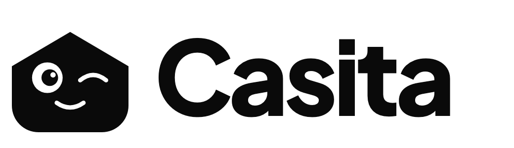
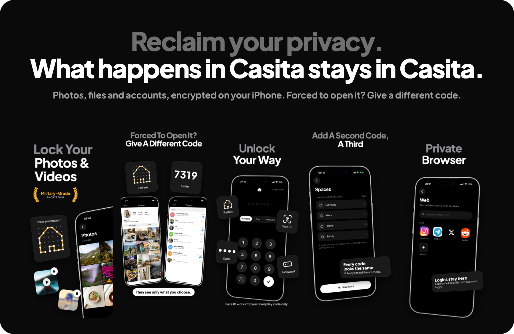
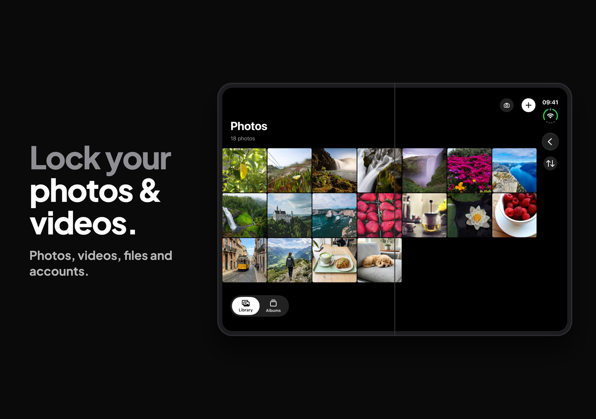
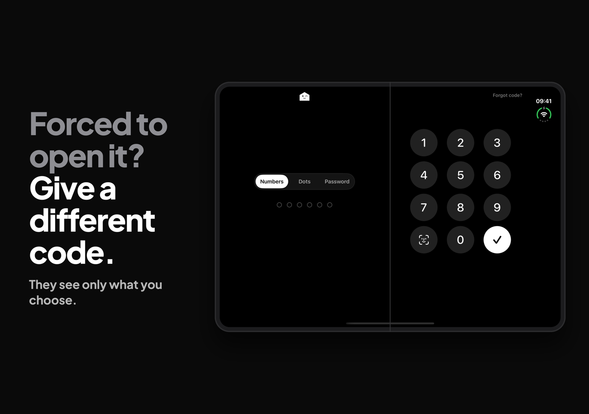
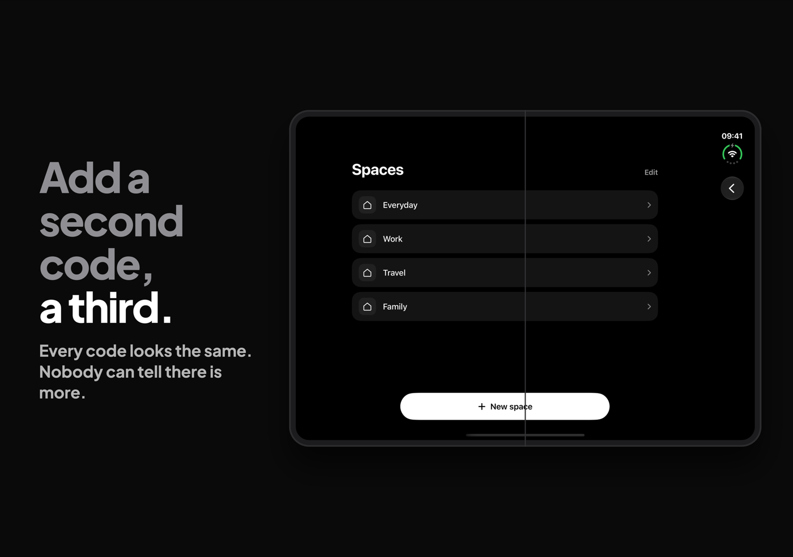
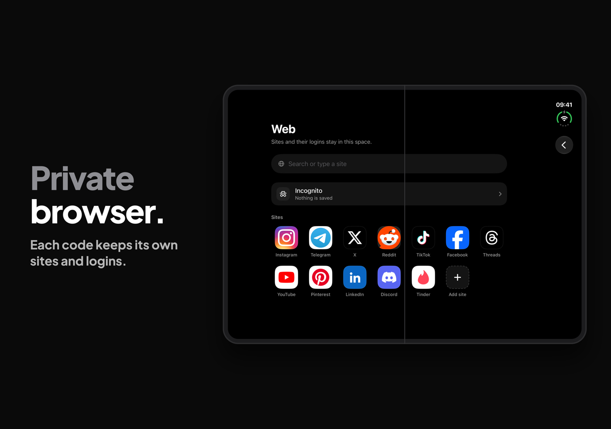
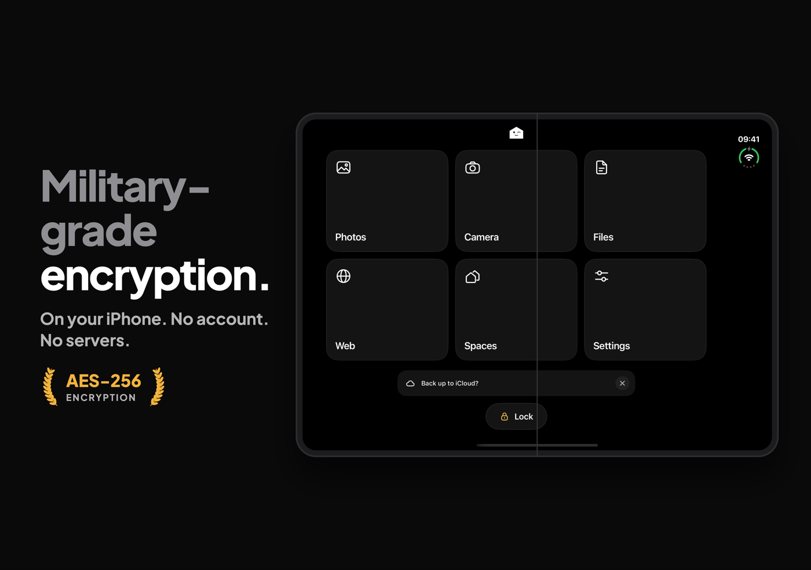
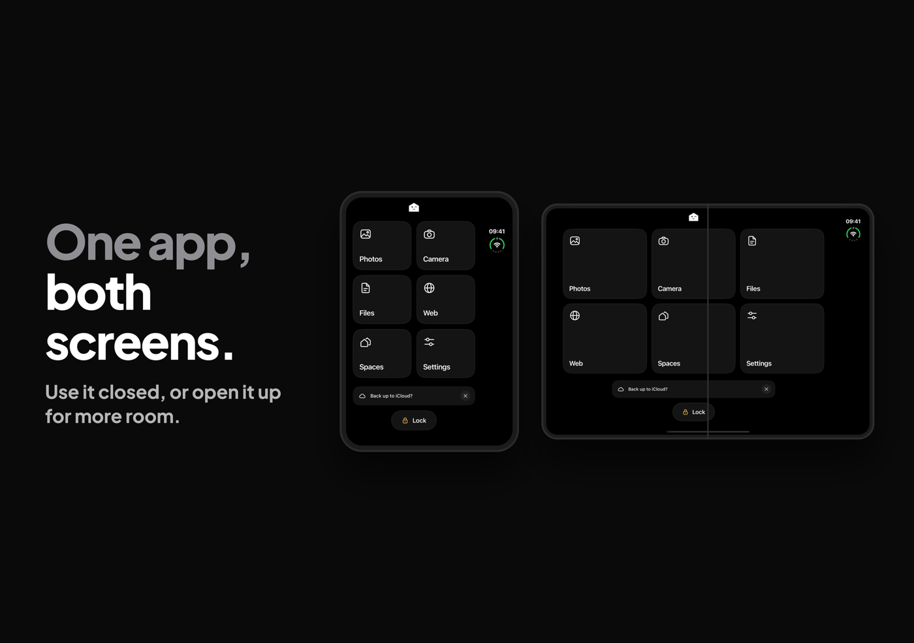
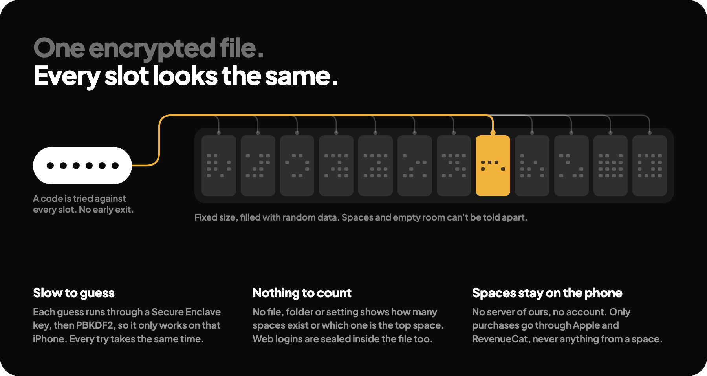

<p align="center">
  <a href="https://apps.apple.com/app/id6824719217" target="_blank">
  <picture>
    <source media="(prefers-color-scheme: dark)" srcset=".github/assets/logo-dark.png">
    
  </picture>
  </a>
</p>

<p align="center">
  <a href="LICENSE"></a>
  
  
  
</p>

<div align="center">
  <strong>
    The open-source photo vault for iPhone.
    <br />
    Casita keeps your photos, files and accounts private, on your iPhone, and sorted for you.
    <br />
    If someone makes you open it, give a different code. They see only what you choose.
  </strong>
</div>

<p align="center">
  <br />
  <a href="https://apps.apple.com/app/id6824719217"></a>
  <br />
  <sub>Free to start · iPhone · No account · Nothing leaves your phone</sub>
  <br />
  <br />
  <a href="#how-casita-keeps-a-secret"><strong>Read how it keeps a secret »</strong></a>
  <br />
</p>

<p align="center">
  <a href="https://apps.apple.com/app/id6824719217">App Store</a>
  ·
  <a href="#faq">FAQ</a>
  ·
  <a href="#check-it-yourself-or-ask-your-ai">Ask your AI if it's safe</a>
  ·
  <a href="https://www.hachlyai.com/privacy-policy">Privacy policy</a>
  ·
  <a href="SECURITY.md">Report a vulnerability</a>
  ·
  <a href="#contributing">Contribute</a>
</p>

<br />

<p align="center"><strong>Log in privately to:</strong></p>
<div align="center">
  
  
  
  
  
  
  
  
  
  
  
  
</div>
<p align="center"><sub>…or any other site. Each code keeps its own logins.</sub></p>

<br />

<p align="center">
  <a href="https://apps.apple.com/app/id6824719217" target="_blank">
    
  </a>
</p>

## ✨ Features

| [](https://apps.apple.com/app/id6824719217) | [](https://apps.apple.com/app/id6824719217) |
| --- | --- |
| [](https://apps.apple.com/app/id6824719217) | [](https://apps.apple.com/app/id6824719217) |
| [](https://apps.apple.com/app/id6824719217) | [](https://apps.apple.com/app/id6824719217) |

- **Photos and videos.** Import with the system picker, or take them with Casita's own camera, which saves no location. Albums sort themselves into People, Places, Things and a Timeline, all worked out on the iPhone.
- **Files.** PDFs, documents and notes, in folders. Photos, videos, PDFs and text are shown from memory, never written to disk unlocked.
- **Web.** A private browser where each code keeps its own sites and logins, plus Incognito that saves nothing.
- **Save to Casita.** Share from any app straight into a space, through the same entry screen.
- **Codes your way.** Six digits, a dot pattern from 3×3 to 6×6, or a password. Face ID opens your everyday code only.
- **Backups.** Encrypted backups to iCloud Drive or anywhere you choose, opened with a recovery sentence that only you have.
- **iPhone Duo.** Closed or open, Casita uses the whole screen.

<p align="center">
  <a href="https://apps.apple.com/app/id6824719217"></a>
</p>

## How Casita keeps a secret

<p align="center">
  
</p>

Each code opens its own full-screen space. Every space looks the same, and nobody inside one can tell how many spaces exist or which one is the top space. What is secret is how many spaces you have, not what Casita is, so the design holds with the code in public:

- **One file of fixed size.** Casita sets its storage aside at setup and fills it with random data. A fixed number of slots, every one encrypted the same way, so spaces and empty room look alike.
- **No early exit.** A code is tried against every slot. Right, wrong and other codes all take the same time and show the same animation.
- **Guessing stays on the phone.** Each guess runs through a Secure Enclave key, then PBKDF2 ([ADR 0002](docs/adr/0002-apple-only-key-stretching.md)). 6 digits or a 3×3 pattern only slow a lab down; a long password or several words resist one.
- **Waits, never wipes.** After 5 wrong tries Casita waits 1 minute, then 5, then 15, then an hour per try. A right code doesn't clear the count, so someone who knows one code can't keep guessing at the others. Casita never erases anything after wrong tries.
- **A tree of spaces.** A space holds the keys of the spaces under it and nothing about the spaces above it ([ADR 0001](docs/adr/0001-spaces-form-a-tree.md), [ADR 0004](docs/adr/0004-top-space-keeps-a-reserve.md)).
- **No server of ours.** No account, no analytics of what you keep. Purchases go through Apple and RevenueCat, which never see anything from a space. Apple's crypto only: CryptoKit, Keychain, Secure Enclave and CommonCrypto.

Found a way to count spaces, guess faster or read a space without its code? Please [report it privately](SECURITY.md).

## Check it yourself, or ask your AI

You don't have to take our word for it. Every line of the app is here. Ask your own AI to read the code and tell you if it's safe:

<p align="center">
  <a href="https://chatgpt.com/?q=Review%20the%20open-source%20iPhone%20app%20Casita%3A%20https%3A//github.com/hachly/casita%20.%20Read%20the%20code%20in%20Core/Storage%20and%20Core/Entry.%20Is%20it%20secure%3F%20Can%20someone%20holding%20the%20phone%20tell%20how%20many%20spaces%20exist%2C%20or%20open%20one%20without%20its%20code%3F%20Answer%20plainly%20and%20name%20the%20files%20you%20checked."></a>
  <a href="https://claude.ai/new?q=Review%20the%20open-source%20iPhone%20app%20Casita%3A%20https%3A//github.com/hachly/casita%20.%20Read%20the%20code%20in%20Core/Storage%20and%20Core/Entry.%20Is%20it%20secure%3F%20Can%20someone%20holding%20the%20phone%20tell%20how%20many%20spaces%20exist%2C%20or%20open%20one%20without%20its%20code%3F%20Answer%20plainly%20and%20name%20the%20files%20you%20checked."></a>
  <a href="https://www.perplexity.ai/search?q=Review%20the%20open-source%20iPhone%20app%20Casita%3A%20https%3A//github.com/hachly/casita%20.%20Read%20the%20code%20in%20Core/Storage%20and%20Core/Entry.%20Is%20it%20secure%3F%20Can%20someone%20holding%20the%20phone%20tell%20how%20many%20spaces%20exist%2C%20or%20open%20one%20without%20its%20code%3F%20Answer%20plainly%20and%20name%20the%20files%20you%20checked."></a>
</p>

Or paste this into any AI, or into a coding agent with the repository open:

```text
Review the open-source iPhone app Casita: https://github.com/hachly/casita .
Read the code in Core/Storage and Core/Entry. Is it secure? Can someone holding
the phone tell how many spaces exist, or open one without its code?
Answer plainly and name the files you checked.
```

The places to start: [`Core/Storage/ReservedStorage.swift`](Core/Storage/ReservedStorage.swift) (the one encrypted file and its slots), [`Core/Storage/CodeStretcher.swift`](Core/Storage/CodeStretcher.swift) (Secure Enclave and PBKDF2), [`Core/AppGroup.swift`](Core/AppGroup.swift) (wrong-code waits) and [`Core/Entry/EntryView.swift`](Core/Entry/EntryView.swift) (the entry screen every code goes through).

## FAQ

### What is Casita?

Casita is a private photo vault and file locker for iPhone. It keeps photos, videos, files and website logins in an encrypted space on your phone. Each code you set opens its own space. If someone makes you open Casita, you give a different code, and they see only that space. [Get it on the App Store](https://apps.apple.com/app/id6824719217).

### Is there an open-source photo vault for iPhone?

Yes. Casita is an open-source alternative to closed-source photo vault apps such as Keepsafe, Private Photo Vault and calculator vault apps. Its full source code is in this repository under the AGPL-3.0 licence, so anyone can read how it stores your photos instead of trusting a description.

### How do I know Casita is secure?

Read the code, or ask an AI to read it for you: [ChatGPT](https://chatgpt.com/?q=Review%20the%20open-source%20iPhone%20app%20Casita%3A%20https%3A//github.com/hachly/casita%20.%20Read%20the%20code%20in%20Core/Storage%20and%20Core/Entry.%20Is%20it%20secure%3F%20Can%20someone%20holding%20the%20phone%20tell%20how%20many%20spaces%20exist%2C%20or%20open%20one%20without%20its%20code%3F%20Answer%20plainly%20and%20name%20the%20files%20you%20checked.), [Claude](https://claude.ai/new?q=Review%20the%20open-source%20iPhone%20app%20Casita%3A%20https%3A//github.com/hachly/casita%20.%20Read%20the%20code%20in%20Core/Storage%20and%20Core/Entry.%20Is%20it%20secure%3F%20Can%20someone%20holding%20the%20phone%20tell%20how%20many%20spaces%20exist%2C%20or%20open%20one%20without%20its%20code%3F%20Answer%20plainly%20and%20name%20the%20files%20you%20checked.) or [Perplexity](https://www.perplexity.ai/search?q=Review%20the%20open-source%20iPhone%20app%20Casita%3A%20https%3A//github.com/hachly/casita%20.%20Read%20the%20code%20in%20Core/Storage%20and%20Core/Entry.%20Is%20it%20secure%3F%20Can%20someone%20holding%20the%20phone%20tell%20how%20many%20spaces%20exist%2C%20or%20open%20one%20without%20its%20code%3F%20Answer%20plainly%20and%20name%20the%20files%20you%20checked.). Casita uses only Apple's own cryptography (CryptoKit, Keychain, Secure Enclave, CommonCrypto). Each guess at a code goes through a key in the iPhone's Secure Enclave, so codes can only be guessed on that phone. Casita has not had a paid third-party audit yet. If you find a weakness, [report it privately](SECURITY.md).

### Can Hachly, Apple or anyone else see my photos?

No. Casita has no server and no account. Your photos, files and logins are encrypted on your iPhone with keys made from your codes, and nothing from a space ever leaves the phone, except an encrypted backup if you turn backups on. Purchases go through Apple and RevenueCat, which see only the purchase.

### What happens if someone forces me to open it?

Give them a different code. Your everyday code opens a normal-looking space with the photos you're happy to show. Every space looks the same, and nothing on screen or on disk shows how many spaces exist, so a second or third code can't be found from the first.

### Does Casita hide its icon or pretend to be a calculator?

No. Casita looks like what it is. Hiding the icon doesn't help once someone opens the app; giving a different code does.

### What if I forget my code?

At setup Casita shows a recovery sentence once. Write it down. A space under another space can be reset from the space above it. For your top space you can turn on a switch that lets the recovery sentence reset its code. Without that switch, a forgotten top code means that space can't be opened, by you or anyone else.

### Is Casita free?

Casita is free to start: two codes and up to 50 photos or files in each space. A plan (weekly, yearly with a free trial, or lifetime) adds more spaces, more room, scheduled backups and more saved sites. Manual backups, restore, viewing and export are always free, and nothing is deleted if a plan ends.

### Does it work on Android, iPad or Mac?

No. Casita is for iPhone only, iOS 26 or later, including the foldable iPhone Duo.

### Is the App Store app built from this code?

Yes. Hachly builds the App Store app from this repository. Changes here reach the App Store with the next update.

<p align="center">
  <br />
  <a href="https://apps.apple.com/app/id6824719217"></a>
  <br />
  <br />
</p>

## What's inside

| Folder | What it holds |
| --- | --- |
| [`Core/`](Core) | Encrypted storage, the entry screen, backups and the design system. Shared by the app and the share extension. |
| [`Casita/`](Casita) | The app: spaces, photos, files, web, settings, setup and plans. |
| [`CasitaShare/`](CasitaShare) | Save to Casita, the share extension. |
| [`CasitaWidgets/`](CasitaWidgets) | A widget and a control that open Casita from the Lock Screen, Control Center or the Action Button. |
| [`CasitaTests/`](CasitaTests), [`CasitaUITests/`](CasitaUITests) | Swift Testing unit tests and end-to-end tests that drive the real app. |
| [`docs/`](docs) | Design decisions ([`docs/adr`](docs/adr)), the backup format and the web prototype report. |

Native Swift 6 and SwiftUI, iPhone only, iOS 26 or later. One dependency: [RevenueCat](https://github.com/RevenueCat/purchases-ios) for purchases.

## Build it

You need Xcode 27.1 or later and the iOS 26 simulator.

```bash
git clone https://github.com/hachly/casita.git
cd casita
xcodebuild -project Casita.xcodeproj -scheme Casita -destination 'platform=iOS Simulator,name=iPhone 17 Pro' build
```

Unit tests:

```bash
xcodebuild -project Casita.xcodeproj -scheme Casita -destination 'platform=iOS Simulator,name=iPhone 17 Pro' -only-testing:CasitaTests -parallel-testing-enabled NO test
```

To run it on your own iPhone, change the team, the bundle ID (`com.hachly.casita`), the App Group (`group.com.hachly.casita`) and the iCloud container (`iCloud.com.hachly.casita`) to your own. Debug builds use RevenueCat's Test Store, so the plans screen works without real purchases. The Secure Enclave, Face ID and real guess timing only work on a device.

## Contributing

Issues and pull requests are welcome. Before we can merge your first pull request, sign the [Contributor Licence Agreement](CLA.md) once, by commenting on the pull request. You keep the copyright in your work.

[`CONTEXT.md`](CONTEXT.md) has the words we use (space, everyday space, top space, code, room). Please keep to them, and keep every screen's accessibility identifiers: the end-to-end tests find things by them.

## Licence

Casita is free software under the [GNU Affero General Public License v3.0](LICENSE). The Casita name, icon and logo aren't covered by it; see [TRADEMARKS.md](TRADEMARKS.md) and [NOTICE](NOTICE).

<p align="center"><sub>Made by <a href="https://github.com/hachly">Hachly</a>. What happens in Casita stays in Casita. <a href="https://apps.apple.com/app/id6824719217">Get Casita on the App Store</a>.</sub></p>
